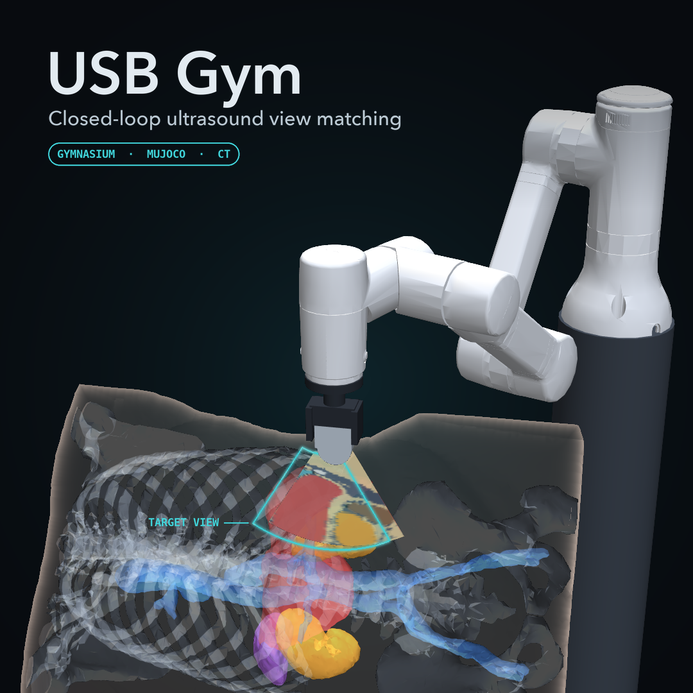
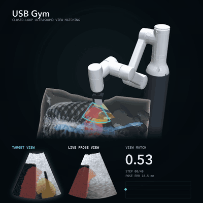

# USB Gym: A Gymnasium Testbed for Closed-Loop Ultrasound View Matching

<p align="center">
  
  
</p>

<p align="center"><sub>Right: one recorded closed-loop episode on a held-out patient (kidney view),
chosen for display; the article reports results over all episodes. The robot arm is an illustration
only: USB Gym moves the probe directly and includes no robot.</sub></p>

Article: [arXiv:2611.08352](https://arxiv.org/abs/2611.08352) ([Citation](#citation)).

USB Gym (UltraSound B-mode Gym, Python package `usbg`) is a CT-based testbed for closed-loop ultrasound
probe view matching. For any probe pose over a patient's labeled CT it renders the B-mode frame the
probe would see and resolves probe-skin contact in MuJoCo. In the view-matching task an agent sees the
current frames and a target frame of the same patient, outputs a bounded six-axis probe twist at each
step, and tries to reproduce the target view, which is rendered at a screened acoustic window.

One step of the loop: probe pose, CT label slice at that pose, physics B-mode render, mapping into the
convex sector geometry, optional texture stage, observation, controller, twist, MuJoCo contact, next
pose. Every stage is a slot that takes a replacement through a small interface, so a published method
can be plugged into one slot while the rest of the loop stays fixed.

Scope: all closed-loop results come from simulation; no physical probe, phantom or robot was used. The
tissue model is rigid, and USB Gym claims no clinical validity.

Contents: [Install](#install) | [Quickstart](#quickstart) | [Data preparation](#data-preparation) |
[Slots](#slots) | [Body contact surface](#body-contact-surface) |
[Plugging in a component](#plugging-in-a-component) | [Leaderboard](#leaderboard) |
[Segmenter trainer](#segmenter-trainer) | [Running the pipeline](#running-the-pipeline) |
[Tests and CI](#tests-and-ci) | [Layout](#layout) | [Citation](#citation) | [License](#license) |
[Errata](#errata)

## Install

USB Gym installs from one clone, needs Python 3.12 or later, and runs on the CPU, on Apple MPS or on CUDA;
no step requires a GPU.

```bash
git clone --recurse-submodules https://github.com/tohnperfect/USBGym.git && cd USBGym
python3 -m venv .venv && source .venv/bin/activate          # Windows: .venv\Scripts\activate
python -m pip install --upgrade pip
# CPU-only PyTorch on Linux and Windows (on macOS, or for a CUDA build, the default PyPI wheels are fine)
python -m pip install torch torchvision --index-url https://download.pytorch.org/whl/cpu
python -m pip install -e ".[dev]"     # usbg, pytest and scikit-image; extras: plug, analysis, body

# no data needed: the contract check, the fast test suite and a rendering example
python -m usbg.contracts_bridge
python -m pytest -m "not slow" -q -o addopts="" -rs tests
python examples/custom_translator.py
```

Notes:

- On Apple Silicon set `PYTORCH_ENABLE_MPS_FALLBACK=1`, so that operators MPS lacks fall back to the
  CPU. The device defaults to MPS when it is available, else the CPU.
- The extra `plug` installs scikit-image, which the SSIM appearance term of the reward slot needs
  (`pip install -e ".[plug]"`; the extra `dev` includes it). The other published plug-in methods need
  their own packages (for example Stable-Baselines3 for the controller slot, LPIPS for the reward slot,
  nnU-Net v2, SAM, MedSAM or SAMUS for the mask-source slot, TotalSegmentator for the anatomy slot); each
  adapter's docstring names what it imports. Their weights are downloaded under their own terms (see
  [License](#license)).
- The extra `body` installs scikit-image, trimesh and fast-simplification, which the opt-in body contact
  surfaces need (`pip install -e ".[body]"`; see [Body contact surface](#body-contact-surface)).
- The shell runners call `.venv/bin/python`, so keep the virtual environment at `.venv/` in the
  repository root (a POSIX layout; on Windows run the Python scripts directly).
- `third_party/lotus` is the original LOTUS code as a git submodule (`--recurse-submodules` above, or
  `git submodule update --init`; `USBG_LOTUS_DIR` points elsewhere). It is needed only by the plugged
  `lotus_orig` renderer and its tests; `usbg.render_lotus` reimplements the LOTUS forward model in
  device-agnostic PyTorch and does not import it.

## Quickstart

One held-out evaluation episode with a plugged toy texture stage, `my_stage`:

```python
import gymnasium as gym
import numpy as np
import usbg.gym_env  # registers USBGym/ViewMatch-v0

def my_stage(img01):  # a toy texture stage: frame to frame
    return np.clip(img01, 0.0, 1.0) ** 1.5

env = gym.make("USBGym/ViewMatch-v0", base="servo", device="cpu",
    patients="test", texture=my_stage,
    mask="ct",  # privileged evaluation reference
    privileged_info=True)  # privileged evaluation reference
obs, info = env.reset(options={"eval_episode": 0})
for _ in range(12):
    obs, r, term, trunc, info = env.step(np.zeros(6, np.float32))
print(info["privileged"]["pose_error_mm"])  # privileged, printed last
```

Building the environment calibrates the image-servo base on the 13 training patients through the same
stage. The zero residual then leaves that base in control for all 12 steps. The lines marked privileged,
the printed pose error among them, use simulator state that no physical rig provides. The CT-free
configuration, in which controller and reward see only images, replaces them with `mask="learned"`, a
segmenter checkpoint (`seg_ckpt=` or `US_SEG_CKPT`) and `privileged_info=False`.

The quickstart needs the CT label caches and the screened acoustic windows of
[Data preparation](#data-preparation). `examples/view_match_gym.py` runs a random policy and the servo
base on several episodes.

## Data preparation

The repository ships no datasets; it ships one derived protocol file, the windows file below. Download
each dataset from its source under its terms:

| Dataset | Used for | License and access |
| :-- | :-- | :-- |
| TotalSegmentator CT dataset (Wasserthal et al., 2023), small subset v2.0.1, Zenodo record 10047263 | Anatomy: 19 CTs (13 training, 6 held-out patients) | [CC BY 4.0](https://creativecommons.org/licenses/by/4.0/); the windows file and the leaderboard's episode setups are derived from it (see [NOTICE](NOTICE)) |
| Abdominal ultrasound set of Vitale et al. (2020), Kaggle | Real pool of the texture stages; segmenter training and real targets | Its original license, as stated on its Kaggle page |
| Open Kidney Ultrasound Data Set, KidneyUS (Singla et al., 2023) | Segmenter training (training split); real targets (holdout split) | CC BY-NC-SA; images after registration with its maintainers |
| Annotated Ultrasound Liver, AUL (Xu et al.), Zenodo record 7272660 | Real liver targets only | CC BY 4.0 |

Run every command from the repository root with the virtual environment active. The blocks are bash.

```bash
export PYTHONPATH=src PYTORCH_ENABLE_MPS_FALLBACK=1 USBG_SEAT=anatomical

# 1. TotalSegmentator small subset (Zenodo record 10047263) -> data/raw/totalseg_small/<case>/
mkdir -p data/raw
#    download Totalsegmentator_dataset_small_v201.zip from https://zenodo.org/records/10047263 into data/raw/
unzip -q data/raw/Totalsegmentator_dataset_small_v201.zip -d data/raw/totalseg_small

# 2. label caches for the 19 cases: source caches, then the bladder-free caches the anatomical seat reads
for c in $(python -c "from usbg.benchmark import TRAIN_PATIENTS as A, TEST_PATIENTS as B; print(' '.join(A + B))"); do
  USBG_SEAT=canonical python scripts/build_ct_volume.py data/raw/totalseg_small/$c --out data/cache/$c.npz
done
python scripts/build_anat_cache.py --workers 5          # -> data/cache_anat/<case>.npz, build_report.json

# 3. screened acoustic windows
python scripts/build_windows.py --workers 5             # -> data/cache/windows/usbg-windows-v1.json
```

The windows file stores its creation time, so a rebuilt file has a new md5. The windows file of the
reported runs ships as package data, `src/usbg/data/usbg-windows-v1.json` (md5
`af35f0bddeb57c079981eb0ba8aca5b3`); set `USBG_WINDOWS` to it, or copy it to
`data/cache/windows/usbg-windows-v1.json`, to run the same episodes as those runs. Every result
records the md5 of the windows file it read.

Real ultrasound (needed for texture stages, learned masks and real targets):

```bash
# Vitale et al. (Kaggle): the unlabeled training-split pool and the annotated test set
python scripts/ingest_kaggle_us.py --src /path/to/kaggle_download --size 128 \
    --pool-dir data/real/kaggle_vitale/pool --test-out data/eval/kaggle_vitale_test.npz
```

KidneyUS, AUL and the fixed split of the annotated Vitale frames are prepared by the segmenter trainer
(`segtrain/scripts/ingest_kidneyus.py`, `ingest_aul.py`, `make_vitale_split.py`; see
[segtrain/README.md](segtrain/README.md)). Training with KidneyUS frames (`--kidneyus`) also needs the
fixed KidneyUS test assignment of the reported runs, `segtrain/data/real/kidneyus_split.npz`, which no
script of this repository writes and which is not yet published; until it is, the segmenter recipe with
KidneyUS, and with it the texture slot of the leaderboard, runs with the maintainers.

The patient split is frozen in `src/usbg/benchmark.py`: 13 training patients (`TRAIN_PATIENTS`) and
six held-out patients (`TEST_PATIENTS`: s0358, s0513, s0519, s0591, s0649, s0762). Held-out patients
enter no texture stage, segmenter or policy, and the leakage gate checks this through every artifact's
lineage. Do not reshuffle the split.

## Slots

The loop has eight configurable components; six are plug slots. A replacement provides the interface
in the second column. Privileged components read simulator state that no physical rig provides.

| Component | Interface | Reference component | Code |
| :-- | :-- | :-- | :-- |
| Anatomy source (slot) | a labeled CT volume per patient | TotalSegmentator dataset masks | `usbg.volume`, `scripts/plug/totalseg_labels.py` |
| Acoustic windows | screening rules; target organs | screened windows; liver and kidney targets | `usbg.windows`, `usbg.placement` |
| Renderer (slot) | a label slice to a frame in [0, 1]; physics-renderer parameters | physics renderer | `usbg.render_lotus`, `usbg.plug.renderers` |
| Texture stage (slot) | a frame to a frame; a label-conditioned stage also reads the label slice | SonoSPADE | `usbg.texture_gan`, `usbg.plug_texture` |
| Mask source (slot) | a frame to an organ mask | U-Net of the same stage and seed; CT label (privileged) | `usbg.us_segmenter`, `usbg.plug.masks` |
| Contact | probe contact in MuJoCo, on or off; the contact surface | on; plane through the target window face (privileged); press capped at 5 mm. Opt-in: the patient's CT skin or a fitted avatar torso ([Body contact surface](#body-contact-surface)) | `usbg.mujoco_env`, `usbg.placement`, `usbg.body_scene` |
| Controller (slot) | any map from the observation to a normalized twist | REINFORCE residual over the image-servo base | `scripts/train_view_match_rl.py`, `usbg.plug.controllers` |
| Reward (slot) | a frame pair to a score; the weights of the match score S | S with weights 0.6 and 0.4, action cost 0.003 | `usbg.view_match`, `usbg.plug.rewards` |

The reward uses no pose: `S = w_seg * S_seg + w_app * S_app`, where `S_seg` averages over the organs the IoU
between the organ masks of the two frames and `S_app` maps a normalized cross-correlation over the sector
interior to [0, 1]. The step reward is the gain in `S` minus the action cost.

The typed protocols `Renderer`, `TextureTranslator`, `MaskSource` and `Reward` in
[`usbg.interfaces`](src/usbg/interfaces.py) need no subclassing.

## Body contact surface

By default the probe presses a flat surface through the target window face, as in the article. Two
opt-in body surfaces replace it, for contact on a curved body and for viewing the scene:

- `ct_skin`: the patient's own skin, the outer surface of the CT label volume. It comes from the voxel
  grid of the imaged anatomy, so the contact surface and the image agree.
- `avatar`: a generic adult torso shipped with the package (`src/usbg/data/avatar_torso.obj`, CC0 1.0;
  see [NOTICE](NOTICE)), fitted to the patient's CT skin by a similarity transform. The fit leaves a
  residual of tens of millimetres (27 mm RMS on s0011), so under the probe the avatar skin can lie above
  or below the CT skin, and contact then happens on a surface that is not the imaged one.
  `info["surface_gap_mm"]` gives that offset at the target window: -15.9 mm at the first liver window of
  s0011, where the window face lies inside the avatar.

Both need the `body` extra. MuJoCo collides a body through 12 convex slabs stacked along its long axis,
and the 5 mm press cap acts along the nearest slab face. A body never moves or scales the CT.

```bash
# per surface: a self-contained scene file (inline meshes), its seat record and an image
python scripts/make_body_scene.py --case s0011 --organ liver --window 0 --surface both --png
python -m mujoco.viewer --mjcf=outputs/body_scene/s0011_liver_w0_ct_skin.xml   # slabs: geom group 3
```

```python
env = gym.make("USBGym/ViewMatch-v0", device="cpu", contact_surface="ct_skin")  # or "avatar"
obs, info = env.reset(options={"contact_surface": "avatar"})                    # this episode only
```

The scene file needs the label cache of the case ([Data preparation](#data-preparation)). The article's
results and the leaderboard use the default surface; a run on a body surface is a different
configuration and reports `contact_surface` in its provenance. The robot arm of the cover image is not
part of the package.

## Plugging in a component

Plug protocol: swap one slot at a time and hold the rest of the loop at that slot's reference condition.
A new method then meets the same 60 held-out episodes (six held-out patients, evaluation seed 999) as
the slot's reference component and is evaluated at 12 steps. Train on the 13 training patients only,
fix every setting before any held-out run, give reinforcement learners the reference controller's
57,600 environment steps and imitation learners its 40,000 samples, run learned methods with seeds 0,
1 and 2, and run plugged networks with batch normalization in evaluation mode. Before any of its
numbers is used, an adapter passes the admission gate (`scripts/plug/admission_gate.py`; it runs on
training patients only and with CUDA hidden): a non-privileged adapter must give identical outputs with
its privileged inputs removed or randomized, a privileged adapter must be caught reading them, and
outputs on the CPU and on MPS must agree within fixed tolerances.

The snippets assume `PYTHONPATH=src` and `USBG_SEAT=anatomical`. `usbg.plug.viewmatch_env.ViewMatchEnv`
is the copy of `usbg.gym_env.ViewMatchEnv` that the plug adapters were built on (the plug results of the
article come from it). The two classes have the same logic and give the same poses and scores for the
same actions; they are separate classes with separate volume caches, both register
`USBGym/ViewMatch-v0`, and the first module imported registers it.

**Texture stage** (`usbg.interfaces.TextureTranslator`: a callable from an `H x W` float frame in
[0, 1] to one of the same shape).

```python
import numpy as np
from usbg.plug.viewmatch_env import ViewMatchEnv

class Gamma:                                          # any callable img01 -> img01
    def __call__(self, img01):
        return np.clip(img01, 0.0, 1.0) ** 0.8

env = ViewMatchEnv(patients="train", texture=Gamma(), mask="ct", device="cpu")
```

A trained stage loads from its checkpoint: register a loader with
`@usbg.texture_gan.register_translator("arch")` and store `state["arch"]` in the checkpoint, as
`usbg.plug_texture` does for UNSB and histogram matching. Existing scripts take a plugged stage through
`scripts/plug_texture_exec.py <script.py> --translator unsb --texture-ckpt <ckpt> ...`, and
`scripts/plug_texture.py tex fastcut 0` trains one with the reference recipe.

**Mask source** (`usbg.interfaces.MaskSource`: `segment(img01)` returns an `int64` mask in the
repository ontology `{0 background, 1 liver, 2 gallbladder, 3 vessel, 4 kidney, 7 spleen}`).

```python
from usbg import view_match as VM
from usbg.plug.masks import load_mask_source
from usbg.plug.viewmatch_env import ViewMatchEnv

seg = load_mask_source("kind=tv,ckpt=<us_seg_lraspp_mbv3_sonospade_s0.pt>")   # or kind=nnunet, sam, medsam
VM.set_mask_source(seg)                 # every loop and trainer in this process; None = CT label
env = ViewMatchEnv(patients="train", texture="physics", mask=seg, device="cpu")   # or one environment
```

`scripts/plug/eval_plug_mask.py --mask-plug <spec> -- <eval_view_ladder args>` runs a ladder rung with
it. SAM and MedSAM boxes taken from the CT label (`prompt=ct`) are privileged, and the output is flagged
as such. The segmenters themselves are trained with the [segmenter trainer](#segmenter-trainer).

**Controller** (the Gymnasium environment: the last 4 frames and the target frame in, a normalized
six-axis twist out, 12 steps per episode).

```python
from stable_baselines3 import PPO
from usbg.benchmark import TEST_PATIENTS, TRAIN_PATIENTS
from usbg.plug import controllers as C

env = C.make_env(patients=list(TRAIN_PATIENTS), texture="physics", mask="ct", privileged_info=False,
                 frame_dtype="uint8", device="cpu")
env = C.FiniteHorizonTerminal(C.StackedGoalObs(env))  # one uint8 image; the horizon ends the episode
model = PPO("CnnPolicy", env, gamma=0.9, seed=0).learn(57_600)
test = C.make_env(patients=list(TEST_PATIENTS), texture="physics", mask="ct", device="cpu")
res = C.evaluate(test, C.SB3Controller(model, "ppo"), n_episodes=60)   # reset(options={"eval_episode": k})
```

`scripts/plug_train_sb3.py --algo {ppo,sac,td3,a2c,dqn,bc,dagger,cem,...}` does the same with the
reference servo base (`--base servo --servo-base <policy .pt>`), budgets and evaluation, and refuses
held-out training cases.

**Reward** (`usbg.interfaces.Reward`: the potential `S`; the step reward stays
`S_t - S_{t-1} - effort |rho|^2`). The `ssim` potential needs scikit-image (the extra `plug`).

```python
from usbg.plug.rewards import PluggedRewardWrapper, RewardPlug
from usbg.plug.viewmatch_env import ViewMatchEnv

env = PluggedRewardWrapper(ViewMatchEnv(patients="train", texture="physics", mask="ct", device="cpu"),
                           reward="ssim")   # paper, ncc_sector, ncc_frame, ssim, nmi, mi, lpips, pose, pose_area

class OrganDice(RewardPlug):                          # your own potential
    def __init__(self):
        self.name, self.privileged = "organ_dice", False

    def potential(self, cur_img, cur_lab, tgt_img, tgt_lab, **kw):
        a, b = cur_lab > 0, tgt_lab > 0
        return float(2 * (a & b).sum() / max(a.sum() + b.sum(), 1))

env = PluggedRewardWrapper(ViewMatchEnv(patients="train", texture="physics", mask="ct", device="cpu"),
                           reward=OrganDice())
```

`scripts/plug_reward_train.py --reward ssim -- <train_view_match_rl args>` trains the reference learner
with a named potential, while evaluation and keep-best stay on `S`. The `pose` rewards are privileged
and need `privileged_info=True`.

**Renderer** (`usbg.interfaces.Renderer`: an `int64` label slice to a float32 B-mode frame in [0, 1]).

```python
import numpy as np
from usbg import render_lotus as R
from usbg.plug import renderers as PR
from usbg.plug.viewmatch_env import ViewMatchEnv

@R.register_renderer("flat")                          # then R.render(label_slice, renderer="flat")
def flat(label_slice, *, device=None, cfg=None, **kw):
    return np.where(label_slice > 0, 0.5, 0.0).astype(np.float32)

with PR.plugged("lotus_orig"):                        # the loop's renders: lotus_orig, lotus_reimpl or simus
    obs, info = ViewMatchEnv(patients="train", texture="physics", mask="ct", device="cpu").reset(seed=0)
```

`scripts/plug_render_run.py --renderer lotus_orig -- eval_view_ladder <args>` runs a ladder rung, the
trainer or the landscape with a plugged renderer. The loop draws every frame with
`render(label, "physics", cfg)`, so a new renderer enters the loop as a new entry next to the three
published ones in `usbg.plug.renderers`.

**Anatomy source.** `scripts/plug/totalseg_labels.py` rebuilds the label caches of the same CTs from
TotalSegmentator v2 automatic labels (task `total`, fast mode) with the class mapping of
`scripts/build_anat_cache.py`.

**Job files.** The plug scripts `scripts/plug_*_jobs.py` and `scripts/plug/make_plug_*_jobs.py` write
one JSON job per run (command, output, dependencies, expected inputs), and
`scripts/plug/merge_plug_jobs.py` merges and checks them; `scripts/run_table4_v2.py --extra-jobs <file>`
runs such a file with dependencies and resumption. `scripts/plug/episode_audit.py` checks that a plugged
row ran the same episodes as the reference row.

## Leaderboard

[LEADERBOARD.md](LEADERBOARD.md) lists every published method plugged into a slot (the rows of Table 5 of
the article, with their references and DOIs in its methods list) and the methods added since. Each row
ships with its per-episode values, and `python -m usbg.leaderboard recompute` rebuilds every printed cell
from them. To add a method, follow [SUBMITTING.md](SUBMITTING.md): start from a slot's template plug-in,
pass the admission gate (`python -m usbg.leaderboard check`), run the unchanged plug protocol
(`python -m usbg.leaderboard run`, which writes `submission.json`), check the file
(`python -m usbg.leaderboard validate`), then open the "Leaderboard submission" issue form and paste it.
For a slot whose condition needs an artifact that is not released, paste the gate record instead, and
the maintainers run the plug-in. A new row is post hoc and outside the pre-specified families: its p is
shown unadjusted, beside its patient-by-seed interval, and it gets no pre-specified decision word. Each
slot lists its published rows in the order of Table C.1 of the article: the reference, then the rows by mean
error with the privileged rows last, then the reference's seed-0 line with the rows run at seed 0 only. The
rows are not a ranking: each was tested against its slot's reference only. The maintainers add a row
with `python -m usbg.leaderboard add`, which resolves the method's DOI at Crossref or DataCite and builds
its reference in the methods list from that record. The leaderboard commands need an editable install
from a clone (`pip install -e .`), because the runner uses the clone's `scripts/` and `segtrain/` folders.

**Release assets.** The renderer slot evaluates the physics-trained reference policies of seeds 0 to 2,
attached to the GitHub release v2.2.0 as six files: `usbg_physics_policy_s0.pt`, `_s1.pt` and `_s2.pt`
(weights and servo base) and their `.json` configurations. `python -m usbg.leaderboard fetch` downloads
them and checks each sha256 and size against `src/usbg/leaderboard/data/assets.json`, and the runner
checks them again before a run. They were trained only on physics renders of the 13 training CTs of the
TotalSegmentator dataset (no real ultrasound, no held-out patient). License: Apache-2.0 for the authors'
weights; the TotalSegmentator dataset's CC BY 4.0 attribution applies (Wasserthal et al., 2023,
doi:10.5281/zenodo.10047263).

## Segmenter trainer

The learned mask source and the segmenters of the mask-source slot are trained by the vendored
trainer in [`segtrain/`](segtrain/README.md) (package `us_seg`, the authors' own code). It renders
simulated training frames with `usbg` from the training patients only, adds the public real frames, and
writes the checkpoints and `seg_manifest.json` that the gym's runners read. The gym loads a checkpoint
through `usbg.us_segmenter` (`US_SEG_CKPT`) and does not import `us_seg` at run time. The gym scripts
find the trainer's outputs through `USBG_SEG_REPO` (default `segtrain/`).

## Running the pipeline

The commands below rebuild the reference components and the oracle ladder from the public data. Run
them from the repository root with `PYTHONPATH=src USBG_SEAT=anatomical`.

```bash
# texture stages (training patients only) -> data/dataset/v2/, outputs/v2/textures/manifest.json
bash scripts/run_textures_v2.sh                          # SMOKE=1 runs a tiny version

# texture-matched segmenters (four stages, seeds 0, 1 and 2) -> segtrain/outputs/v2/
(cd segtrain && USBG_SEAT=anatomical scripts/run_seg_v2.sh sonospade physics cut cyclegan)

# oracle ladder cascade: print the queue, then run it three jobs at a time
python scripts/run_table4_v2.py --out outputs/v2/table4 --dry-run
python scripts/run_table4_v2.py --out outputs/v2/table4 --k 3
python scripts/agg_table4_v2.py outputs/v2/table4      # episodes_long.csv, registration_long.csv, cells.json

# leakage gate over the result files
python scripts/check_leakage.py --expect-seat anatomical \
    --results $(find outputs/v2/table4 -mindepth 2 -name '*.json' ! -name '*.provenance.json' | sort) \
    --json outputs/v2/leakage_gate.json
```

The ladder has six rungs on identical held-out episodes (`scripts/eval_view_ladder.py`): the analytic
pose oracle (privileged), the CT-mask servo, the learned-mask servo (the stage with its own segmenter),
the servo base on its own, a static rung and a scripted sweep. The controller is the image-servo base plus a
bounded residual, trained by imitation and then by REINFORCE (`scripts/train_view_match_rl.py
--fix-residual --residual-image --ibvs-features rich`). The runner reuses an output only if its
provenance (seat, texture md5, segmenter md5, windows md5) matches, and reports other outputs as stale.

Other evaluations: `scripts/view_match_landscape.py` and `scripts/agg_table3.py` (reward landscape),
`scripts/eval_realism.py` and `scripts/eval_fid_kid.py` (distance to real frames in matched sector
geometry), `scripts/dr_probe.py` (domain-randomization parameters), `scripts/eval_real_registration.py`
(offline registration to real targets), `scripts/fig_matched_layout.py` (each annotated real frame next
to the best-matching held-out CT view), and `scripts/bench_render.py`, `bench_latency.py` and
`bench_closed_loop.py` (compute cost).

Every trained artifact gets a `<artifact>.provenance.json` sidecar (training cases, real data, seed,
seat, parents, git state, command), and every result JSON carries a `provenance` block
(`src/usbg/provenance.py`). The leakage gate resolves each artifact's lineage through its parents and
fails on a held-out patient in any training set, a stale md5 or mixed seat modes.

## Rebuilding the article's tables and figures

The tables and figure data files of the article and its supplement are rebuilt from the result files of the
reported runs. Those files are archived in a separate results archive on Zenodo,
[doi:10.5281/zenodo.23913142](https://doi.org/10.5281/zenodo.23913142) (the folder `usbgym_results`: the result
files, `MANIFEST.tsv` with the sha256 of every file and the tables and figures it feeds, and `EXCLUDED.tsv` for
the few inputs left out for third-party terms). The build is in `scripts/paper/`, with the analysis scripts it
imports in `scripts/analysis/`; [scripts/paper/README.md](scripts/paper/README.md) gives the environment, the
single steps and the items that need the inputs left out. From the repository root, with ROOT the unzipped
folder `usbgym_results`:

```bash
PYTHONPATH=src python scripts/paper/reproduce.py --results ROOT --out DIR
```

DIR is an output folder outside ROOT. The build runs in public mode only (the marker file `scripts/PUBLIC_MIRROR`):
it reads the code and ROOT, checks every file `ROOT/MANIFEST.tsv` lists and every result file it opens against
that manifest, writes to DIR, and compares every output with `scripts/paper/public_inputs/expected/`, one PASS,
FAIL or NEEDS line per file (NEEDS: an item whose input the archive leaves out). The exit code is 0 when no file
fails and ROOT holds the archive's `MANIFEST.tsv`, 1 on a failure, and 3 when no file fails but ROOT holds
another manifest (see scripts/paper/README.md).

## Tests and CI

```bash
python -m pytest -m "not slow" -q -o addopts="" -rs tests scripts/paper scripts/analysis   # the fast suite, as CI runs it
python -m pytest -q -o addopts="" -rs tests                      # every test of the testbed, slow ones included
```

Without local data the fast suite runs everything that needs none: the renderers, the MuJoCo contact
model, the seat geometry on an analytic phantom, the plug adapters on synthetic inputs, the runner and
aggregator logic, the private-data guard and `tests/test_vendor_regression.py`, which checks the
data-free pipeline against a stored reference within the float tolerance it states. Tests that need the
CT caches, the windows file or trained checkpoints skip and name the missing file (`-rs`).

The tests of the table and figure build (`scripts/paper`, `scripts/analysis`) run on small synthetic inputs;
the ones that rebuild from the results archive run when `USBG_TEST_RESULTS_ROOT` names ROOT and skip otherwise.
The full rebuild among them also needs the rebuild environment of
[scripts/paper/README.md](scripts/paper/README.md) ("Environment"; `pip install -e ".[dev]"` alone lacks some of
its packages) and skips without it.

CI (`.github/workflows/tests.yml`) installs the package with CPU-only PyTorch on Ubuntu, Windows and
macOS for every push, pull request and version tag, imports every `usbg` module and the main scripts,
checks the vendored contract, and runs the fast suite.

During the test suite an audit hook (`tests/conftest.py`) raises on any Python-level read of a private
data path, and `tests/test_private_data_guard.py` statically scans for readers the hook cannot see. No
result of this release uses private or institutional data.

## Layout

```
src/usbg/              the package
  volume.py, slicer.py, seatmode.py, windows.py, placement.py    CT anatomy, slicing, seat and windows
  render_lotus.py      physics renderer, RenderConfig, domain randomization; LOTUS reimplementation
  mujoco_env.py        probe pose and contact, force-capped press
  body_scene.py, body_surface.py, register_body.py              opt-in body contact surface, scene file
  view_match.py        sector mapping, texture-stage call, match score S, mask source
  gym_env.py           the Gymnasium environment USBGym/ViewMatch-v0
  goal_rl.py, policy.py                                         start sampling, residual policy
  texture_gan.py, plug_texture.py                               texture stages and plugged stages
  segmenter.py, us_segmenter.py                                 U-Net and the learned mask source
  plug/                plug adapters (renderers, masks, controllers, rewards), admission gate
  leaderboard/         the plug-slot leaderboard: row statistics, protocol, runner, validator, templates, data
  provenance.py, benchmark.py, interfaces.py                    sidecars, patient split, protocols
  _par/                vendored contract, SE(3) math and scan geometry
  data/usbg-windows-v1.json                                     the windows file of the reported runs
  data/avatar_torso.obj                                         the avatar torso (CC0 1.0)
scripts/               data preparation, training, evaluation, plug scripts and job builders
  paper/               the table and figure build of the article (public mode, results archive)
  analysis/            the statistics and table steps the build imports
segtrain/              the vendored organ-segmenter trainer (us_seg)
examples/              runnable templates: custom texture stage, custom mask source, the environment
tests/                 the test suite
third_party/lotus      the original LOTUS code (git submodule)
LEADERBOARD.md         the leaderboard and its methods list (generated)
SUBMITTING.md          how to add a method to the leaderboard
```

Modules written for retired v1 tasks (the RL demonstrator, the (image, action) dataset generator,
behavior cloning, visibility RL and goal-conditioned reaching) remain in the package for the record; no
result of this release uses them, and their training scripts are not included. `USBG_SEAT=canonical` restores
the v1 seat for auditing only.

## Citation

If you use USB Gym, cite the article, an arXiv preprint (the preferred citation of
[CITATION.cff](CITATION.cff)):

```bibtex
@misc{usbgym2026arxiv,
  title         = {{USB Gym}: A Gymnasium Testbed for Closed-Loop Ultrasound View Matching},
  author        = {Intharah, Thanapong and Gao, Zhichao and Liu, Yiliang and Dong, Hao},
  year          = {2026},
  eprint        = {2611.08352},
  archivePrefix = {arXiv},
  primaryClass  = {cs.CV},
  doi           = {10.48550/arXiv.2611.08352},
  url           = {https://arxiv.org/abs/2611.08352}
}
```

and the software release you used:

```bibtex
@software{usbgym2026,
  title   = {{USB Gym}: A Gymnasium Testbed for Closed-Loop Ultrasound View Matching},
  author  = {Intharah, Thanapong and Gao, Zhichao and Liu, Yiliang and Dong, Hao},
  year    = {2026},
  version = {2.3.0},
  doi     = {10.5281/zenodo.23942190},
  url     = {https://github.com/tohnperfect/USBGym},
  license = {Apache-2.0}
}
```

Authors: Thanapong Intharah (corresponding author; Visual Intelligence Laboratory, Department of
Statistics, Faculty of Science, Khon Kaen University, Khon Kaen 40002, Thailand), Zhichao Gao, Yiliang
Liu and Hao Dong (School of Computer Science, Peking University, Beijing 100871, China).

The SonoSPADE texture stage is a published component; cite it when you use it:

```bibtex
@inproceedings{sonospade2026,
  title     = {{SonoSPADE}: Real-Time, Per-Tissue Ultrasound Texture Synthesis for Closed-Loop Acquisition},
  author    = {Intharah, Thanapong and Gao, Zhichao and Dong, Hao},
  booktitle = {Medical Image Computing and Computer Assisted Intervention, MICCAI 2026 Workshops and
               Challenges (SASHIMI)},
  series    = {Lecture Notes in Computer Science},
  volume    = {17258},
  publisher = {Springer Nature},
  address   = {Cham},
  year      = {2026},
  url       = {https://papers.miccai.org/miccai-2026-sat/SASHIMI_035.html}
}
```

## License

USB Gym is licensed under the Apache License 2.0 ([LICENSE](LICENSE), [NOTICE](NOTICE)), including the
vendored segmenter trainer in `segtrain/` and the vendored code in `src/usbg/_par/`. The LOTUS forward
model in `src/usbg/render_lotus.py` and its acoustic table in `src/usbg/volume.py` are adapted from the
MIT-licensed LOTUS code, whose copyright and permission notice is in NOTICE. The windows file and the
leaderboard's episode setups are derived from the TotalSegmentator dataset (CC BY 4.0; NOTICE). The avatar
torso `src/usbg/data/avatar_torso.obj` is derived from a Blender Studio base mesh dedicated to the public
domain (CC0 1.0; NOTICE names the source). Third-party
code, weights and data keep their own licenses: LOTUS (MIT, submodule), and the packages and weights used by
the plugged methods, including SAM and MedSAM (Apache-2.0), SAMUS (MIT), LPIPS (BSD-2-Clause),
scikit-image (BSD-3-Clause), torchvision (BSD-3-Clause; pretrained weights may carry terms from their
training data), TotalSegmentator (Apache-2.0), nnU-Net v2 (Apache-2.0), Stable-Baselines3 (MIT) and
PyMUST for SIMUS (GNU LGPL). The datasets are listed under [Data preparation](#data-preparation).
Segmenters trained on KidneyUS frames inherit its terms.

## Errata

[ERRATA.md](ERRATA.md) lists the defects found in the earlier public release (v1, package version
0.1.0), what changed, and where each change is checked. [CHANGELOG.md](CHANGELOG.md) lists the changes
by version, and [DATASHEET.md](DATASHEET.md) describes the data behind the testbed.
